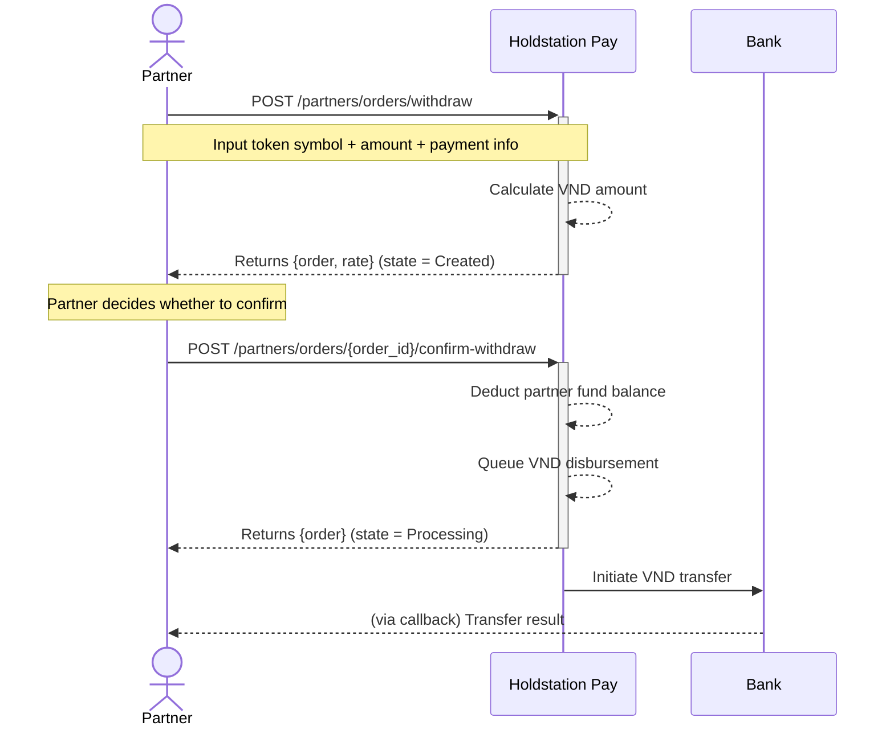
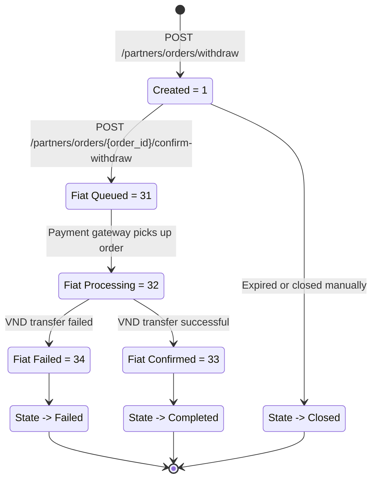

Prefund a stablecoin balance with Holdstation Pay and create offramp orders instantly — no need to wait for on-chain confirmation on every order.

You top up your balance once — with on-chain stablecoin deposits, or with VND bank transfers to a [deposit account](#vnd-deposit-accounts) — then debit it directly whenever you create an offramp order, and Holdstation Pay pays out VND to the recipient's bank account.

<Note>
  Contact the Holdstation team to enable this feature for your account.
</Note>

<Note>
  All prefunding endpoints require signed authentication. See [Request Signing](/guides/partner-authentication-signed-api/overview) for how to sign requests.
</Note>

## Workflow

1. **Get deposit addresses** — call [List Deposit Addresses](/api-reference/funds/list-deposit-addresses) to retrieve the on-chain addresses assigned to you on each supported chain.
2. **Deposit on-chain** — send supported tokens (e.g., USDT, USDC) to one of those addresses. Holdstation Pay credits the received amount to your balance once the deposit is detected.
   - **Or deposit VND** — call [Get VND Deposit Account](/api-reference/funds/get-deposit-va) and transfer VND to the bank account it returns. See [VND Deposit Accounts](#vnd-deposit-accounts).
3. **Check balance** — use [List Funds](/api-reference/funds/list-funds) to view all balances, or [Get Fund Balance](/api-reference/funds/get-balance) for a single token.
4. **Create offramp order** — call [Create Withdrawal from Fund](/api-reference/funds/withdraw) to create an order with a confirmed quote (rate, outcome, fees). No VND is sent yet — the order is held for up to **15 minutes** awaiting confirmation. Always include an `idempotency_key` to avoid duplicate orders.
5. **Confirm disbursement** — call [Confirm Withdrawal](/api-reference/funds/confirm-withdraw) with the `order_id` from step 4 to release the payout. Holdstation Pay debits your balance and sends VND to the recipient bank account using the details on the order. If not confirmed within 15 minutes, the order expires and must be recreated.
6. **Balance Change History** — use [List Fund Logs](/api-reference/funds/list-logs) to review every balance change (deposits, offramp debits, and compensations/refunds).
7. **Balance Change Webhook** — to get notified the moment your prefund balance changes, configure a partner-level webhook URL via [Set Partner Webhook URL](/api-reference/partners/set-webhook-url). See [Balance Change Webhook](/guides/webhooks/balance-change-webhook) for the event headers, payload, and `change_type` values.

## VND Deposit Accounts

As well as on-chain stablecoin deposits, a partner can top up with **VND bank transfers**. Holdstation Pay issues you a dedicated bank account; any transfer into it credits your VND fund.

<Note>
  Holdstation Pay sets the provider for each partner. You do not choose it.
</Note>

### Getting your account

Call [Get VND Deposit Account](/api-reference/funds/get-deposit-va) — it returns your account, opening one if there is none. The call is idempotent: **calling it again returns the same account**, so it is safe to retry or to call on every startup.

The response carries the details to give to whoever is sending the money:

| Field | Notes |
|---|---|
| `id` | Deposit account ID — use it on the close and transactions endpoints |
| `provider` | Provider holding the account, e.g. `GPAY` |
| `account_number` | Bank account number to transfer VND to |
| `account_name` | Account holder name the sender's bank shows |
| `bank_code` | Bank the account is on, e.g. `BIDV` |
| `status` | `ACTIVE` or `CLOSED` |
| `created_at` | ISO 8601 timestamp |

Use [List VND Deposit Accounts](/api-reference/funds/list-deposit-vas) to see every account you hold across providers, closed ones included.

### Receiving a deposit

Any bank transfer to the account credits your VND fund. Holdstation Pay charges a **deposit fee**: the credited `amount` is what the sender transferred **minus** `fee`, so the sender's transfer equals `amount` + `fee`.

Each credit is reported by the [Balance Change Webhook](/guides/webhooks/balance-change-webhook), and the same credit appears in [List Fund Logs](/api-reference/funds/list-logs). To review the transfers through one account — with sender name, account, bank BIN, and the transfer note — call [List Deposit Account Transactions](/api-reference/funds/list-deposit-va-transactions). Each entry's `id` is the fund log ID.

### Closing an account

[Close VND Deposit Account](/api-reference/funds/close-deposit-va) stops transfers to it being accepted.

<Warning>
  Closing is not reversible. Getting an account again afterwards opens a **new account with a different account number** — it does not reopen the closed one. Make sure every sender has the new details before you close the old account.
</Warning>

## Change Types

Every balance change is recorded in the fund logs with a `change_type`:

| Value | Type | Description |
|---|---|---|
| `1` | Deposit | On-chain deposit credited to the balance |
| `2` | Withdraw | Debit from an offramp order |
| `3` | Compensation/Refund | Adjustment by Holdstation Pay (e.g., refund or correction) |

## Withdraw Order Flow

## Processing States Flow

See the full processing state table in [Order Flow → Withdraw Orders](/guides/order-flow#withdraw-orders-prefunded-disbursement).

## Endpoints

| Method | Path | Description |
|---|---|---|
| GET | `/partners/funds` | List all balances |
| GET | `/partners/funds/balance` | Get balance for a single token |
| GET | `/partners/funds/deposit-addresses` | List on-chain deposit addresses |
| POST | `/partners/funds/deposit-vas` | Get the VND deposit account, opening one if there is none |
| GET | `/partners/funds/deposit-vas` | List VND deposit accounts across all providers |
| POST | `/partners/funds/deposit-vas/{va_id}/close` | Close a VND deposit account |
| GET | `/partners/funds/deposit-vas/{va_id}/transactions` | List VND transfers credited through one deposit account |
| GET | `/partners/funds/logs` | List balance-change history |
| POST | `/partners/orders/withdraw` | Create a withdraw order (quote only, pending confirmation) |
| POST | `/partners/orders/{order_id}/confirm-withdraw` | Confirm the order and release the VND payout |
| POST | `/partners/webhook-url` | Set the URL that receives [Balance Change Webhook](/guides/webhooks/balance-change-webhook) events |

## Withdraw Error Codes

Both [`POST /partners/orders/withdraw`](/api-reference/funds/withdraw) and [`POST /partners/orders/{order_id}/confirm-withdraw`](/api-reference/funds/confirm-withdraw) return a numeric `code` in the response body when the operation cannot be completed. Use this code to drive retries and partner-side error handling.

| `code` | Name                          | Meaning                                                                                                |
|--------|-------------------------------|--------------------------------------------------------------------------------------------------------|
| `1`    | `INVALID_INPUT`               | The request body failed validation (missing or malformed fields, unsupported currency, etc.).          |
| `2`    | `PARTNER_NOT_FOUND`           | The authenticated partner cannot be resolved.                                                          |
| `3`    | `INSUFFICIENT_BALANCE`        | The partner's fund balance for the requested token is below the order amount + fees.                   |
| `4`    | `DUPLICATE_REQUEST`           | The `idempotency_key` has already been used to create another withdraw order.                          |
| `5`    | `ORDER_NOT_FOUND`             | No order matches the supplied `order_id` (confirm-withdraw only).                                      |
| `6`    | `ORDER_NOT_OWNED_BY_PARTNER`  | The order exists but belongs to a different partner (confirm-withdraw only).                           |
| `7`    | `INVALID_ORDER_STATE`         | The order is not in a state that allows confirmation (e.g., already confirmed, expired, or closed).    |
| `8`    | `INVALID_ORDER_TYPE`          | The order is not a withdraw order (confirm-withdraw only).                                             |
| `99`   | `INTERNAL_ERROR`              | Unexpected server error; safe to retry after a short backoff.                                          |
